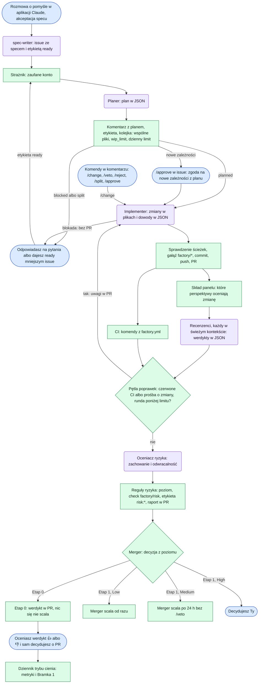

# Factory

Fabryka oprogramowania oparta na Claude Code i GitHub Actions. Zamienia rozmowę o pomyśle w zweryfikowany pull request z oceną ryzyka. Ty decydujesz, co się scala, i robisz to z telefonu. Pierwszy projekt to strona WWW. Gry w Godot są w planach.

> **Status: Etap 0, tryb cienia.** Taśma prowadzi zadanie od pomysłu do werdyktu w PR, ale niczego nie scala. Przy każdym PR zapisuje, co by zrobiła, a Ty oceniasz ten werdykt. Automatyczny merge włączy się w Etapie 1, gdy werdykty będą trafne (Bramka 1 w dzienniku).

## Co potrafi

- **Spec z rozmowy, także z telefonu.** Skill `spec-writer` dopytuje o decyzje produktowe w krótkich rundach (do 5 pytań w jednej wiadomości) i zakłada issue z kryteriami akceptacji, które da się sprawdzić maszynowo.
- **Plan.** Planer rozpisuje podejście, pliki, testy i dowody dla każdego kryterium. Gdy czegoś nie wie, pyta. Za duże zadanie dzieli na mniejsze issue.
- **Implementacja w PR.** Implementer pisze kod i testy na gałęzi `factory/<numer>-<nazwa>` i podaje dowód dla każdego kryterium. Gdy nie może dokończyć zadania, zgłasza blokadę zamiast oddawać połowiczny PR.
- **Recenzja.** CI uruchamia komendy projektu. Pięć perspektyw (poprawność, testy, bezpieczeństwo, utrzymanie, zgodność ze specem) ocenia PR, każda w świeżym kontekście. Projekt może dodać własne perspektywy.
- **Zrzuty ekranu.** Komenda projektu robi po CI zrzuty sekcji obok wzorca, przed zmianą i po niej. Recenzent wyglądu ocenia tylko sekcje, które zmienił PR, a Ty dostajesz w PR linki do tych samych par.
- **Pętla poprawek.** Czerwone CI albo prośba recenzenta o zmiany odsyła PR do implementera z listą uwag, do 3 rund.
- **Ocena ryzyka.** Deterministyczne reguły (strefy plików, testy, rozmiar, dowody) i ocena modelu, która może poziom tylko podnieść. Wynik: Low, Medium albo High, raport w PR czytelny na telefonie.
- **Tryb cienia i dziennik.** Werdykt fabryki w PR oceniasz 👍 albo 👎. Przypięte issue „Tryb cienia” pokazuje zgodność, rundy poprawek, czas i koszt na PR, etap i recenzenta.
- **Kolejka i limity.** Zadania na tych samych plikach idą po kolei, a reszta równolegle w granicach `wip_limit`. Dzienny limit przebiegów z Claude pilnuje kosztu, a zadanie ponad limit rusza samo następnego dnia.
- **Nowe zależności tylko za Twoją zgodą.** Plan z nowym pakietem czeka na `/approve`, a pakiet instaluje workflow, nie model.
- **Bezpieczeństwo.** Claude działa tylko z prawem odczytu i zwraca JSON albo patch. Zapisy robią skrypty. Fabryka nie zmienia własnych zabezpieczeń.

**Jeszcze nie:**
- automatyczny merge (Etap 1): wymaga rulesetu na `main` i aplikacji GitHub fabryki; w repo prywatnym ruleset wymaga GitHub Pro;
- podgląd wdrożenia w PR (`evidence.preview_deploy`), etykiety kierujące do człowieka (`human_gates`), agenci cykliczni (`schedules`): pola są w kontrakcie, ale taśma ich jeszcze nie używa;
- presety i CI dla Godota, hooki pluginu;
- sesja `factory-init`, która ustala konwencje projektu. Na razie konwencje (np. podejście do stylów, język nazw w kodzie) zapisujesz sam w `CLAUDE.md` projektu. Bez nich agent wybierze styl sam, a recenzent nie będzie miał czego pilnować.

## Szybki start

### Czego potrzebujesz

- repo projektu na GitHubie, publiczne albo prywatne (w prywatnym taśma zużywa minuty GitHub Actions);
- subskrypcję Claude Pro albo Max: taśma loguje się nią, a koszt pracy agentów liczy się w limitach subskrypcji;
- raz komputer z Claude Code (CLI), żeby wygenerować token;
- na co dzień telefon: aplikację Claude (spec) i GitHub Mobile (oceny, komendy, merge).

### 1. Token Claude

Na komputerze uruchom `claude setup-token` i zaloguj się kontem z subskrypcją. Skopiuj token. W repo projektu: Settings → Secrets and variables → Actions → New repository secret, nazwa `CLAUDE_CODE_OAUTH_TOKEN`.

### 2. Ustawienia repo

Settings → Actions → General → Workflow permissions: zaznacz „Allow GitHub Actions to create and approve pull requests”. Bez tego taśma nie otworzy PR. Pozostałe uprawnienia workflowy deklarują same.

### 3. Kontrakt `factory.yml`

Skopiuj [`templates/factory.yml`](templates/factory.yml) do korzenia repo projektu i dopasuj:

- `extends`: presety języka i frameworka, np. `[base, typescript, web, nuxt]`;
- `commands`: komendy CI, wymagane `test` i `build`. **`setup` musi zainstalować wszystko**, czego potrzebują pozostałe komendy, także przeglądarki do testów e2e. Implementer uruchamia tylko komendy z tej listy i tylko dosłownie;
- `zones`: ścieżki z danymi trwałymi, autoryzacją i logiką współdzieloną (ścieżka spoza mapy dostaje Medium);
- `zone_tests`: testy spoza ścieżek strefy, które ją sprawdzają, np. e2e całej strony;
- `dependencies`: komendy instalacji nowych pakietów (bez nich plan z nową zależnością się zablokuje);
- `protected_files`: pliki, których agenci nie zmienią.

Sprawdź kontrakt w klonie tego repo (Node 22.18+):

```bash
npm ci
npm run validate -- ścieżka/do/factory.yml
```

Konwencje kodu projektu zapisz w jego `CLAUDE.md`. Czytają je planer, implementer i recenzenci.

### 4. Workflow taśmy

Skopiuj [`templates/workflows/factory.yml`](templates/workflows/factory.yml) do `.github/workflows/factory.yml` w repo projektu. To cienki plik: jeden job wywołuje dyrygenta fabryki (`pipeline.yml`), który rozdziela zdarzenia na etapy. Zmiany etapów działają więc bez kopiowania, a plik zmieniasz tylko przy zmianie wersji fabryki. Dopisz `.factory/review/` do `.gitignore`. Taśma nie potrzebuje aplikacji Claude na GitHubie, bo działa na tokenie workflowu.

### 5. Spec z telefonu

1. Skopiuj katalog [`skills/spec-writer/`](skills/spec-writer/) do `.claude/skills/spec-writer/` w repo projektu.
2. Dopisz regułę z [`templates/claude/CLAUDE.md`](templates/claude/CLAUDE.md) do `CLAUDE.md` projektu. Bez niej sesja od razu koduje, zamiast spisać spec.
3. W claude.ai połącz konto GitHub i daj aplikacji Claude dostęp do repo projektu. Sesja Claude Code w chmurze widzi tylko repo z instalacji tej aplikacji.

Szczegóły i wariant ze zwykłym czatem: [Spec z telefonu](#spec-z-telefonu).

### 6. Pierwsze zadanie

1. W aplikacji Claude: zakładka Code, nowa sesja na repo projektu i np. „Mam pomysł: …”.
2. Odpowiadasz na pytania („ok” albo poprawki numerów) i akceptujesz spec. Powstaje issue z etykietą `ready`.
3. Po kilku minutach w issue jest plan. Gdy planer pyta, odpowiadasz i nadajesz `ready` ponownie. Gdy plan dodaje pakiety, piszesz `/approve`.
4. Implementer otwiera PR. Recenzja i pętla poprawek działają same.
5. W PR pojawiają się raport ryzyka i werdykt fabryki. Werdykt oceniasz 👍 albo 👎, a o PR decydujesz jak zwykle: merge albo `/reject`.
6. Po merge'u issue zamyka się samo, a kolejka uruchamia następne czekające zadanie.

Postęp widać w przypiętym issue „Tryb cienia” i w Actions → factory. Nazwa przebiegu mówi, który etap ruszył, np. `factory implement #7`.

### Aktualizacje

Projekt przypina jedną wersję fabryki w swoim workflowie (`uses: …/pipeline.yml@main` i `factory_ref: main`). Etapy, skille agentów, presety i skrypty fabryki pochodzą z tej wersji przy każdym przebiegu, więc aktualizują się same. W Etapie 0 to `@main`; po nim powstanie tag `v1`: zmiany zgodne trafią do projektów same, a niezgodne do `v2`, na którą przechodzi się świadomie.

Ręcznie, na razie, synchronizujesz tylko kopię skilla `spec-writer` w `.claude/skills/` (sesje w chmurze nie instalują pluginów). Docelowo i to ma się dziać samo.

## Na co dzień: etykiety i komendy

| Etykieta w issue | Znaczy |
| --- | --- |
| `ready` | spec gotowy; nadajesz ją Ty, uruchamia planera |
| `planned` | plan jest; implementacja trwa albo PR jest otwarty |
| `queued` | zadanie czeka w kolejce: wspólne pliki z innym zadaniem, `wip_limit` albo dzienny limit; ruszy samo |
| `needs-approval` | plan dodaje pakiety; czeka na Twoje `/approve` |
| `blocked` | potrzebna Twoja decyzja: pytania planera, blokada implementera albo awaria etapu (powód w komentarzu) |
| `split` | planer podzielił zadanie na mniejsze issue |
| `factory:paused` | taśma jest zatrzymana, a etap czeka; ruszy sam po `/start` (też w PR) |
| `factory:stopped` | issue „Taśma zatrzymana”: otwarte, dopóki taśma stoi |

W PR: `risk:low`, `risk:medium`, `risk:high` (poziom z oceny ryzyka) i `factory:round-N` (runda poprawek).

| Komenda w komentarzu | Gdzie | Co robi |
| --- | --- | --- |
| `/approve` | issue z `needs-approval` | zgoda na nowe pakiety z planu; zadanie trafia do kolejki |
| `/approve`, `/veto` | PR | zapisują Twoją decyzję etykietą; w Etapie 1 sterują merge'em Medium i High |
| `/change <opis>` | PR | runda poprawek według Twojego opisu |
| `/reject` | issue albo PR | odrzuca zadanie, zamyka PR i zwalnia kolejkę |
| `/split` | issue | planer dzieli zadanie na mniejsze issue |
| `/stop <powód>` | issue albo PR | zatrzymuje taśmę: plan, implementacja, recenzja i kolejka czekają, a dziennik i komendy działają |
| `/start` | issue albo PR | wznawia taśmę: etapy wstrzymane w czasie postoju ruszają same, kolejka wypuszcza czekające zadania |

Komendy działają tylko od właściciela repo i kont z wejścia `trusted`.

**Zatrzymanie taśmy** służy do tego, co w fabryce robi się przy wadzie linii: najpierw naprawa, potem dalsza produkcja. `/stop` otwiera issue „Taśma zatrzymana” z powodem. Przebieg, który już trwa, kończy bieżący etap, ale następny nie rusza i dostaje etykietę `factory:paused` z zapisem, co miało ruszyć. `/start` zamyka issue i wznawia zapisane etapy. Etapy wstrzymane w czasie postoju liczą się do dziennego limitu tak jak zwykłe przebiegi.

**Problemy taśmy** zgłaszają agenci, gdy kłopot dotyczy narzędzi albo komend projektu, a nie samego zadania. Przykład: komenda wypisuje błąd, którego zadanie nie usunie. Zgłoszenie widać w komentarzu z planem, w opisie PR albo w komentarzu z blokadą. Dziennik zbiera wszystkie zgłoszenia w sekcji „Problemy taśmy”, a pełna lista trafia do `problemy.csv` na gałęzi `factory-journal`. Zgłoszenie nie zatrzymuje taśmy: decyzja o `/stop` należy do Ciebie.

## Jak działa

Niebieskie kroki wykonuje człowiek, fioletowe agent (Claude, tylko odczyt, zwraca JSON albo patch), a zielone skrypt, czyli deterministyczny job w GitHub Actions.



W Etapie 1 merger zrobi to, co dziś opisuje werdykt: Low scali od razu, Medium po 24 h, jeśli nikt nie da `/veto`, a High zostawi Tobie. Scala deterministyczny skrypt, a nie model.

### Pętla poprawek, blokady i nowe zależności

- **Pętla poprawek.** Czerwone CI albo `request_changes` recenzenta odsyła PR do implementera z komentarzem „Runda poprawek N z M” (uwagi od najpoważniejszej, przy czerwonym CI końcówka wyjścia padających komend), do `risk.max_review_rounds` rund. Przy czerwonym CI recenzenci nie ruszają, bo poprawka i tak zmieni diff; oceniają je dopiero w ostatniej rundzie. Ocena ryzyka i werdykt powstają po pętli. Uwagi nierozstrzygnięte po ostatniej rundzie dają High.
- **Wyjście CI.** `ci.json` ma przy każdej komendzie końcówkę jej wyjścia (30 ostatnich linii stdout i stderr, bez kolorów). Recenzenci szukają w niej dowodu na to, co komenda wypisała, np. czystego typechecku, a implementer może się na nią powołać dowodem `ci: <komenda>`.
- **Runda bez zmian w plikach.** Gdy w rundzie poprawek żadna uwaga nie wymaga zmiany kodu, implementer oddaje `done` z wyjaśnieniem w założeniach. Workflow aktualizuje opis PR, dodaje etykietę rundy i uruchamia recenzję jeszcze raz, bez commita. Limit rund działa tak samo.
- **Blokada.** Gdy implementer nie może dokończyć zadania (brak narzędzia, zależności, uprawnień), kończy ze statusem `blocked` i opisem. Workflow nie otwiera wtedy PR i nie puszcza recenzji: issue dostaje etykietę `blocked` i komentarz z powodem. Tak samo, gdy pierwsza implementacja nie zmieniła żadnego pliku. Poprawka, która potem trafi do PR (np. po `/change`), zdejmuje etykietę `blocked`. Brak sprawdzenia, które i tak zrobi CI (np. komenda spoza `commands`), nie jest blokadą: implementer oddaje zmianę i pisze w założeniach, czego nie uruchomił.
- **Awaria startu.** Bun dla akcji Claude pochodzi z rejestru npm, bo pobieranie z GitHub Releases bywa niedostępne. Gdy sesja Claude mimo to nie wystartuje (brak wyniku albo błąd bez kosztu), etap czeka minutę i próbuje jeszcze raz. Błąd po rozpoczęciu pracy nie jest ponawiany.
- **Nowe zależności.** Planer wpisuje pakiety z wersją do `dependencies` w planie. Plan z nimi czeka z etykietą `needs-approval` na `/approve` w issue. Potem workflow instaluje je komendami z `dependencies` w `factory.yml`, zanim ruszy implementer. Implementer nie dostaje komendy instalacji, bo w jego jobie działa token subskrypcji, a obcy pakiet mógłby go odczytać.

### Kolejka i limity

- Planer wypisuje pliki, które zmieni implementer. Zadanie ze wspólnymi plikami z zadaniem w toku (z planu albo z otwartego PR) czeka z etykietą `queued`, tak samo zadanie ponad `wip_limit`.
- `daily_runs` to dzienny limit przebiegów z Claude: planu, implementacji i recenzji, liczonych po nazwie przebiegu. Kolejka, dziennik i komendy go nie zużywają. Limit sprawdza implementacja nowego zadania; zadanie ponad limit czeka w kolejce. Rundy poprawek otwartego PR limitu nie sprawdzają, bo pętla i tak kończy się po `max_review_rounds`.
- Kolejka rusza po zamknięciu PR fabryki, po `/reject`, po zgodzie na zależności, po blokadzie albo awarii zadania w toku i raz dziennie o 04:17 UTC.

### Zrzuty ekranu

Odpowiadają na pytanie, czy zmiana wygląda jak wzorzec. Projekt podaje w `factory.yml` komendę, którą taśma uruchamia po CI:

```yaml
evidence:
  screenshots: npx playwright test -c playwright.screenshots.config.ts
```

- Komenda zapisuje pliki PNG w katalogu ze zmiennej `FACTORY_SCREENSHOTS`. `<nazwa>@<szerokość>.png` to wykonanie, a `<nazwa>@<szerokość>.ref.png` to wzorzec tej samej sekcji przy tej samej szerokości, np. wycinek makiety. Nazwa ma małe litery, cyfry, `-` i `_`. Wzorzec i szerokość są opcjonalne.
- Lepiej działają zrzuty sekcji niż całej strony: duży obraz model widzi pomniejszony i gubi szczegóły.
- Limity: 150 plików, 5 MB na plik i 100 MB razem. Plik spoza wzorca nazw, plik inny niż PNG albo ponad limit taśma pomija i wymienia w PR.
- Czerwona komenda nie zatrzymuje recenzji. Recenzent i komentarz w PR mówią wtedy, że zrzutów może brakować.
- Implementer może uruchomić tę komendę sam (katalog w `FACTORY_SCREENSHOTS` ustawia workflow) i przed oddaniem zmiany obejrzeć zrzuty zmienionych sekcji obok wzorca.
- **Tylko sekcje zmienione przez PR.** Taśma uruchamia tę samą komendę na punkcie rozgałęzienia, w osobnym katalogu roboczym z komendą `setup`, i porównuje piksele zrzutów przed i po zmianie. Robi to skrypt, nie model. CI trwa przez to kilka minut dłużej, ale nie zużywa Claude.
- **Recenzent wyglądu** `ux-visual` (włączasz go w `reviewers.extra`) dostaje tylko zmienione sekcje i porównuje je ze wzorcem przy każdej szerokości. Gdy żadna sekcja się nie zmieniła, werdykt wystawia skrypt bez sesji Claude. Bez zrzutów bazy, np. przy pierwszej wersji komendy, recenzent dostaje wszystkie zrzuty i sam wybiera te, których dotyczy zmiana. Gdy brakuje zrzutów zmienionych sekcji, daje pewność poniżej 0,8, więc zmiana nie dostanie Low. Zrzuty dostaje tylko perspektywa z `screenshots: true` we frontmatterze, a pozostali recenzenci nie płacą za ich spis.
- **Galeria w PR.** Komentarz „Zrzuty ekranu” ma linki: na wierzchu sekcje zmienione względem gałęzi głównej, reszta zwinięta. Link otwiera jeden obraz z wzorcem po lewej albo u góry i wykonaniem obok albo pod spodem. Linki zamiast obrazów w treści, bo GitHub nie pokazuje w komentarzach obrazów z repo prywatnego. W każdej rundzie, np. po `/change`, taśma dodaje nowy komentarz z numerem rundy pod najnowszymi zdarzeniami, a poprzedni usuwa.
- Obrazy galerii leżą na gałęzi `factory-screenshots`, która ma jeden commit bez historii i tylko zrzuty otwartych PR. Gałąź możesz usunąć w każdej chwili, a taśma założy ją od nowa.

### Tryb cienia

1. Po ocenie ryzyka `merge.yml` dodaje w PR komentarz z werdyktem fabryki. Low: scaliłaby od razu. Medium: czekałaby 24 h na `/veto`. High: przekazałaby decyzję Tobie. Zmiana za duża albo zablokowana przez bramki jakości: odesłałaby ją do podziału albo do poprawek.
2. Na komentarz reagujesz 👍 (zgoda) albo 👎 (niezgoda). Każda kolejna ocena (np. po `/change`) dostaje nowy komentarz, więc reakcja dotyczy konkretnego werdyktu. O samym PR decydujesz jak zwykle: merge, `/reject` albo revert.
3. `journal.yml` prowadzi przypięte issue „Tryb cienia” (etykieta `factory:journal`): stan Bramki 1, metryki i listę PR-ów fabryki. Reakcje nie uruchamiają workflowów, więc dziennik odświeża się po każdym werdykcie, po zamknięciu PR fabryki i raz dziennie. Na żądanie: Actions → factory → Run workflow → `journal`.
4. Przy każdym odświeżeniu dziennik zapisuje statystyki w plikach na gałęzi `factory-journal`. Link do nich jest w issue z dziennikiem.
   - `journal.csv` (GitHub pokazuje go jako tabelę, da się go też wczytać do arkusza) i `journal.json` mają jeden wiersz na zadanie, także bez PR (blokada, podział, odrzucenie): issue, PR, poziom, werdykt, Twoja ocena, stan, rundy oraz koszt na etap i na recenzenta.
   - Gałąź ma jeden commit, który nadpisuje się przy każdym odświeżeniu.

Metryki liczy skrypt, nie model:

- **zgodność**: odsetek werdyktów, które oceniłeś 👍;
- **fałszywe Low**: werdykt „scaliłaby”, który oceniłeś 👎, PR zamknięty bez merge'u albo merge cofnięty w ciągu `revert_days` dni;
- **rundy poprawek** i **czas od `ready` do merge'u**;
- **próg pewności recenzentów**: zakończone PR-y dzielone według najniższej pewności w panelu (≥ 0,8 i < 0,8) z odsetkiem przyjętych (scalonych i niecofniętych) w każdej grupie. Jeśli odsetek jest podobny, pewność nie przewiduje Twoich decyzji i próg zastąpią zgodność recenzentów oraz cytaty, które da się sprawdzić;
- **koszt**: równowartość cen API na PR, na etap (plan, implementacja, recenzja, ocena ryzyka) i na recenzenta, tokeny wyjścia oraz podział wyjścia na rozumowanie, tekst i wywołania narzędzi (w tym kod). Przy subskrypcji pokazuje, ile taśma waży w limitach. Koszt recenzji rundy odesłanej do implementera zapisuje komentarz rundy, bo ta runda nie ma werdyktu.

Bramka 1 przechodzi przy 20 ocenionych PR, zgodności co najmniej 90% i braku fałszywych Low (progi `shadow` w `base`). Dziennik pokazuje wtedy, że można przejść do Etapu 1, ale decyzja należy do Ciebie.

## Szczegóły

### Reguły ryzyka v1

Poziom zmiany to najwyższy wynik z pięciu reguł. Reguły i oceniacz mogą go tylko podnieść.

| Reguła | Co sprawdza |
| --- | --- |
| 1. Strefy | ścieżki plików według mapy stref projektu; ścieżka spoza mapy dostaje Medium, a plik testów spoza mapy liczy się jak `code` |
| 2. Zachowanie i odwracalność | ocena LLM, która może poziom tylko podnieść; zmiana sposobu liczenia kwot to Medium |
| 3. Brak testów | strefa bez testów jest o poziom wyżej; testy strefy leżą w jej ścieżkach albo wskazuje je `zone_tests` |
| 4. Rozmiar | Low: maks. 100 linii i 5 plików; Medium: maks. 400 linii i 15 plików; większe zmiany planer dzieli |
| 5. Dowody | zielone CI, dowód dla każdego kryterium akceptacji (kryterium ze specu, dosłownie albo jednoznaczna parafraza z tej samej pozycji z tymi samymi liczbami), test regresyjny przy poprawce błędu, approve recenzentów z pewnością ≥ 0,8 |

Bramki jakości nie są ryzykiem: blokują merge, ale fabryka poprawia je sama.

| Bramka | Próg |
| --- | --- |
| Długość pliku | ostrzeżenie przy 300 liniach, blokada przy 500; pliki już większe nie mogą rosnąć |
| Długość funkcji | maks. 50 linii |
| Złożoność | maks. 15 |
| Zagnieżdżenie | maks. 4 |

### Kontrakt projektu (`factory.yml`)

Przykład jest w [`templates/factory.yml`](templates/factory.yml). Warstwy składają się w kolejności `base` → presety z `extends` → `factory.yml`. Listy z warstw się sumują, więc projekt może dopisać strefę albo chroniony plik, ale nie może usunąć tych z `base`. Pojedyncze wartości z późniejszej warstwy nadpisują wcześniejsze. Presety: `base`, `typescript`, `web`, `nuxt` (Nuxt 4: komponenty, strony i zasoby w `app/` to Low, serwer, composables, layouty i pluginy to Medium, middleware to High).

| Pole | Kto ustawia | Co znaczy |
| --- | --- | --- |
| `project`, `extends` | projekt | nazwa projektu; presety, `base` zawsze pierwszy |
| `commands` | projekt | komendy CI; wymagane `test` i `build`, reszta dowolna (`setup`, `lint`, `e2e`…); `setup` instaluje wszystko dla pozostałych, bo implementer uruchamia tylko te komendy |
| `dependencies` | projekt | `add` i `add_dev`: komendy instalacji nowych zależności z planu, np. `npm install --save-exact --ignore-scripts`; workflow dokleja `nazwa@wersja` |
| `zones` | wszystkie warstwy | ścieżki w strefach: `data`, `security`, `release`, `dependencies`, `factory`, `shared`, `code` |
| `zone_tests` | wszystkie warstwy | testy spoza ścieżek strefy, które ją sprawdzają (reguła 3), np. `shared: ["e2e/**"]`, gdy e2e sprawdzają układ strony |
| `files` | wszystkie warstwy | klasy plików: `source` (kod), `tests`, `lockfiles`, `generated`, `translations` (reguły 3, 4, bramki i diff dla recenzentów) |
| `disable_markers` | wszystkie warstwy | znaczniki wyłączeń (`eslint-disable`, `@ts-ignore`…), których nowe wystąpienia odbierają Low |
| `assertion_markers` | wszystkie warstwy | znaczniki asercji w testach (`expect(`, `assert`); ich ubytek daje High |
| `protected_files` | wszystkie warstwy | pliki, których agenci nie zapisują |
| `risk.zone_levels`, `risk.unassigned`, `risk.size`, `risk.min_confidence`, `risk.max_review_rounds`, `risk.min_diff_coverage` | tylko `base` | poziomy stref i progi reguł ryzyka |
| `risk.medium_veto_hours` | `base`, projekt | okno weta dla Medium; `0` = Medium jak High |
| `gates` | tylko `base` | progi bramek jakości |
| `exceptions` | projekt | wyjątek od bramki jakości dla ścieżki: `path`, `gate`, `max`, `reason` |
| `reviewers` | `base` (`perspectives`), projekt (`extra`) | perspektywy recenzji: podstawowe zawsze, dodatkowe z katalogu albo z `.factory/perspectives/` |
| `models` | `base`, projekt | model na etapie: `planner`, `implementer`, `risk_assessor`, `reviewers.default` i wybrane perspektywy |
| `wip_limit`, `daily_runs` | `base`, projekt | zadania w toku naraz i dzienny limit przebiegów z Claude ([Kolejka i limity](#kolejka-i-limity)) |
| `shadow` | tylko `base` | progi Bramki 1: `gate_prs`, `min_agreement`, `max_false_low`, `revert_days` |
| `evidence.screenshots` | projekt | komenda, która po CI zapisuje zrzuty PNG ([Zrzuty ekranu](#zrzuty-ekranu)) |
| `evidence.preview_deploy`, `human_gates`, `schedules` | projekt | podgląd wdrożenia w PR, etykiety do człowieka, agenci cykliczni; **taśma ich jeszcze nie używa** |

Wzorce ścieżek są względne od korzenia repo i znają tylko `*` (w obrębie katalogu), `**` (dowolna głębokość, także zero katalogów) i `?`. Wzorzec zaczynający się od `*` trzeba w YAML-u ująć w cudzysłów. Błąd walidacji wskazuje plik i pole, np. `factory.yml: zones.data[1]: nieprawidłowy wzorzec "/abs/**": …`. Z `--json` skrypt wypisuje konfigurację złożoną z warstw.

### Skrypt reguł ryzyka

`scripts/risk-rules.ts` ocenia zmianę między dwiema wersjami repo projektu i zwraca poziom z uzasadnieniem każdej reguły oraz wynik bramek jakości. Ten sam diff daje zawsze ten sam wynik.

```bash
node scripts/risk-rules.ts --repo ścieżka/do/projektu --base origin/main --head HEAD \
  --evidence evidence.json --eslint eslint.json --json
```

- `factory.yml` jest czytany z punktu rozgałęzienia, a nie z samej zmiany. Zmiana `factory.yml` i tak jest High.
- **Reguła 1:** każdy zmieniony plik (przy zmianie nazwy stara i nowa ścieżka) trafia do najwyższej pasującej strefy. Plik testów spoza mapy stref liczy się jak `code`, bo ryzyko samych testów sprawdza reguła 5.
- **Reguła 2:** poziom przychodzi od oceniacza ryzyka w `evidence.json`. Bez tej oceny zmiana nie dostanie Low. Ryzyko produktowe „wysokie” ze specu (`product_risk`) daje High bez względu na ocenę.
- **Reguła 3:** dotyczy kodu (`files.source`) w przypisanej strefie. Strefa ma testy, gdy w repo jest plik z `files.tests` pasujący do jej wzorców albo do jej wzorców w `zone_tests`.
- **Reguła 4:** liczy dodane i usunięte linie oraz pliki bez testów, lockfile'ów, plików generowanych i tłumaczeń. Zmiana ponad progi Medium dostaje High (bezpieczna wartość domyślna) i znacznik podziału: wraca do planera, a do właściciela trafia dopiero, gdy planer stwierdzi, że podziału nie da się zrobić (`split_impossible`).
- **Reguła 5:** Low wymaga zielonego CI, dowodu dla każdego kryterium akceptacji, testu regresji przy poprawce błędu, `approve` każdej perspektywy z panelu z pewnością co najmniej `min_confidence` i braku nowych znaczników wyłączeń w kodzie. Każdy brak daje Medium, także cytat recenzenta, którego nie ma w diffie. `approve` z uwagą o wadze `high` lub `critical` liczy się jak `request_changes`. High dają: nierozstrzygnięta uwaga `high` lub `critical`, usunięty plik testów, gdy testowany kod został (Medium, gdy zmiana usuwa też testowany kod albo dodaje testy z co najmniej tyloma asercjami, czyli testy przeniesiono z przepisaniem), ubytek asercji, pokrycie zmienionych linii poniżej `min_diff_coverage` (gdy CI je liczy) i uwagi nierozstrzygnięte po `max_review_rounds` rundach poprawek.
- **Bramki:** długość pliku liczy skrypt (linie bez pustych i komentarzy). Długość funkcji, złożoność i zagnieżdżenie bierze z raportu `eslint --format json`. Liczą się tylko zmienione pliki.

`evidence.json` składają workflowy:

```json
{
  "ci": "success",
  "acceptance": [{ "criterion": "przycisk jest niebieski", "evidence": "zrzut: button.png" }],
  "bugfix": false,
  "reviews": [
    {
      "perspective": "security",
      "verdict": "request_changes",
      "confidence": 0.85,
      "summary": "Sprawdzony przepływ tokenu w kliencie API i logowanie błędów.",
      "findings": [
        { "severity": "high", "file": "src/api/client.ts", "line": 42, "issue": "Token trafia do logu", "evidence": "console.log(authHeader)" }
      ],
      "risk_signals": ["touches-auth"]
    }
  ],
  "review_rounds": 1,
  "diff_coverage": 92.5,
  "behavior": { "level": "Low", "reason": "zmiana wyglądu, cofa ją jeden revert" }
}
```

Werdykt recenzenta (`reviews[]`) ma stały format: perspektywa, `verdict` (`approve` albo `request_changes`), pewność 0–1, `summary` (co sprawdzone i dlaczego taki werdykt), uwagi z wagą i cytatem z diffu w `evidence` oraz sygnały ryzyka dla oceniacza.

### Agenci

| Agent | Kiedy | Wyjście |
| --- | --- | --- |
| `spec-writer` (skill) | rozmowa o pomyśle w aplikacji Claude | issue ze specem i etykietą `ready` |
| `planner` (skill) | issue z etykietą `ready` | plan w komentarzu i blok JSON: `planned`, `blocked` albo `split`; pliki, testy, dowody, nowe zależności |
| `implementer` (skill) | plan, `/change` albo runda poprawek | zmiany w plikach i blok JSON: `done` albo `blocked`, dowód dla każdego kryterium |
| `review-<perspektywa>` (subagenci) | po implementacji, równolegle | werdykt JSON; tylko `Read`, `Grep` i `Glob`, każdy w świeżym kontekście |
| `risk-assessor` (skill) | po panelu | reguła 2: poziom i uzasadnienie w JSON |

Agenci nie ustawiają etykiet ani checków. Zwracają blok JSON, a workflowy działają dopiero na jego sprawdzonej wersji:

```bash
node scripts/agents/output.ts <plan|implementation|verdict|behavior> odpowiedź-agenta.md
```

Recenzenci mają jedno źródło: wspólny protokół `skills/review/protocol.md` i kryteria w `skills/review/perspectives/<perspektywa>.md`. Pliki `agents/review-*.md` generuje `npm run agents`, a test pilnuje, żeby były aktualne. Diff dla recenzentów nie zawiera lockfile'ów i plików generowanych. Zamiast nich recenzenci dostają streszczenie: liczbę linii, a dla `package-lock.json` dodane, usunięte i zmienione pakiety z wersją, z oznaczeniem hostów spoza rejestru npm.

Implementer zmienia pliki narzędziami do edycji, nazwy i usunięcia robi przez `git mv` i `git rm`, a z komend uruchamia tylko te z `commands`. Patch z plikami chronionymi albo z `.github/` (także po zmianie nazwy) odrzuca skrypt.

### Spec z telefonu

Spec pisze skill `spec-writer` w rozmowie z Claude. Pyta o decyzje produktowe w rundach: najwyżej 5 pytań w jednej wiadomości, każde z proponowaną odpowiedzią. Kolejna runda pyta tylko o to, co otworzyły odpowiedzi. Gdy po 3 rundach zostają otwarte decyzje, proponuje podział na kilka speców. Potem pokazuje spec i po Twoim „tak” zakłada issue z etykietą `ready`, a ta uruchamia planera.

Spec ma sekcje: Cel, Scenariusz, Kryteria akceptacji (sprawdzalne maszynowo), Poza zakresem, Założenia, Ryzyko produktowe (`niskie` albo `wysokie`) i Projekt. Szablon i przykład są w [`skills/spec-writer/SKILL.md`](skills/spec-writer/SKILL.md). Test pilnuje, żeby szablon, przykład i planer znały te same sekcje (`SPEC_SECTIONS` w `scripts/workflow/spec.ts`).

**Domyślnie: sesja Claude Code w repo projektu** (z telefonu: zakładka Code w aplikacji Claude). Sesje w chmurze czytają skille z checkoutu repo, a pluginów z `.claude/settings.json` nie instalują, dlatego projekt trzyma kopię skilla w `.claude/skills/spec-writer/` i regułę z [`templates/claude/CLAUDE.md`](templates/claude/CLAUDE.md) w swoim `CLAUDE.md`. Po zmianie skilla w fabryce kopię w projekcie trzeba podmienić. To zmiana w strefie `factory`, więc zatwierdzasz ją Ty.

**Opcjonalnie: zwykły czat w aplikacji Claude.** Rozmowa startuje szybciej, ale skille w czacie są przypisane do konta, więc fabryka ich tam nie wgra. Robisz to sam, raz i ponownie po każdej zmianie skilla:

1. `npm run skill:zip` tworzy `dist/spec-writer.zip`.
2. W claude.ai: Settings → Capabilities → Skills, wgraj ZIP. Skille wymagają włączonego wykonywania kodu (Code execution).
3. Konektor GitHub potrzebuje prawa zapisu, a repo projektu musi być w instalacji jego aplikacji GitHub; inaczej zapis kończy się błędem 403.

W obu drogach issue zakłada Twoje konto, więc strażnik taśmy je przepuszcza. Bez narzędzia z prawem zapisu spec-writer pokaże spec do skopiowania, a issue założysz ręcznie z etykietą `ready`.

### Perspektywy

Pięć perspektyw z `base` ocenia każdy PR: `correctness`, `tests`, `security`, `maintainability` i `spec`. Projekt dopisuje kolejne w `reviewers.extra` wtedy, gdy ich potrzebuje:

| Perspektywa z katalogu | Ocenia | Kiedy działa |
| --- | --- | --- |
| `ux-visual` | zrzuty sekcji zmienionych przez PR względem wzorca i specu | diff dotyka plików widoku, stylów albo zasobów |
| `accessibility-web` | semantyka, teksty alternatywne, etykiety, kontrast, klawiatura | diff dotyka plików widoku albo stylów |
| `web-performance` | obrazy, rozmiar paczki, ładowanie, przesunięcia układu | diff dotyka kodu, stylów, zasobów albo konfiguracji builda |
| `devils-advocate` | szuka wejścia, które wywróci zmianę | diff dotyka stref `data`, `security`, `release` albo `dependencies` |

**Własna perspektywa projektu** to plik `.factory/perspectives/<nazwa>.md` w repo projektu i jedna linia w `reviewers.extra`. Ocenia ją ogólny recenzent `review-project` według tego samego protokołu:

```markdown
---
name: brand
title: Zgodność z marką
description: Sprawdza kolory i typografię marki.
paths: ["src/components/**", "**/*.css"]   # opcjonalnie; albo zones: [shared]
screenshots: true                            # opcjonalnie: recenzent dostaje zrzuty sekcji zmienionych przez PR
---

Kryteria: na co recenzent patrzy i czego nie ocenia.
```

Bez `paths` i `zones` perspektywa ocenia każdy PR. Skład panelu dla zmiany podaje `node scripts/review/panel.ts --base origin/main`, a reguły ryzyka wymagają werdyktu dokładnie od tych perspektyw. Pliki `.factory/` są w strefie `factory` (High) i są czytane z wersji bazowej, więc zmiana nie poluzuje własnej recenzji.

**Najpierw tanie strażniki.** Recenzent LLM kosztuje przy każdym PR. Gdzie się da, lepiej od początku mieć deterministyczny test w CI. Przykłady: limit rozmiaru paczki, próg Lighthouse, test dostępności axe w testach e2e, test, który nie przepuszcza kolorów zapisanych poza tokenami. Perspektywa LLM przydaje się, gdy projekt dojrzeje.

### Modele

Każdy etap może używać innego modelu, także po to, żeby oszczędzać limity. Wartości startowe są w `base`:

```yaml
models:
  planner: opus          # mało wywołań, a od planu zależy reszta
  implementer: sonnet    # najwięcej tokenów
  risk_assessor: sonnet
  reviewers:
    default: sonnet      # kilka wywołań na każdy PR
    security: opus       # najwyższa stawka
```

Projekt nadpisuje w `factory.yml` tylko to, co chce zmienić, np. `models.reviewers.ux-visual: haiku`. Wartość to alias (`opus`, `sonnet`, `haiku`) albo pełny identyfikator modelu. Model można ustawić tylko dla włączonej perspektywy.

### Workflowy i bezpieczeństwo

Wspólne workflowy to `workflow_call` w tym repo. Projekt wywołuje tylko dyrygenta: `uses: gibkigonzo/factory/.github/workflows/pipeline.yml@main` (w Etapie 0 `@main`, potem tag). Dyrygent wywołuje etapy składnią `$/.github/workflows/<etap>.yml`, czyli z tego repo w tej samej wersji co on. Uprawnienia przyznane przez projekt są sufitem, a każdy etap i job bierze z niego tylko swoje minimum. Mogą go wywoływać także repozytoria prywatne.

| Etap | Uruchamia go | Co robi |
| --- | --- | --- |
| `pipeline.yml` | każde zdarzenie workflowu projektu | dyrygent: rozdziela zdarzenia na etapy poniżej; przy zatrzymanej taśmie (`/stop`) zapisuje wstrzymane etapy zamiast je uruchamiać |
| `plan.yml` | etykieta `ready` na issue | plan w komentarzu, etykieta `planned`, `blocked` albo `split`; przy `planned` uruchamia implementację albo stawia zadanie w kolejce (`queued`, `needs-approval`) |
| `implement.yml` | plan, kolejka, `/change` w PR albo pętla poprawek | dzienny limit, instalacja zatwierdzonych zależności, patch od implementera, sprawdzenie ścieżek, PR z gałęzi `factory/<numer>-<nazwa>`; uruchamia recenzję. Przy blokadzie: etykieta `blocked` i komentarz, bez PR |
| `review.yml` | implementacja | komendy z `factory.yml` (CI), zrzuty ekranu z komentarzem w PR, skład panelu, recenzenci równolegle; pętla poprawek odsyła PR do implementera |
| `risk.yml` | po recenzji, w tym samym uruchomieniu | oceniacz ryzyka, reguły, check `factory/risk`, etykieta `risk:*`, raport w PR |
| `merge.yml` | po ocenie ryzyka, w tym samym uruchomieniu | w Etapie 0 tylko werdykt trybu cienia w nowym komentarzu |
| `journal.yml` | po werdykcie, po zamknięciu PR fabryki, raz dziennie | dziennik trybu cienia w przypiętym issue i statystyki zadań na gałęzi `factory-journal`; po scaleniu PR fabryki zamyka jego issue |
| `queue.yml` | po zamknięciu PR fabryki, po `/reject`, po zgodzie na zależności, raz dziennie | uruchamia implementację czekających zadań, które mieszczą się w limitach |
| `commands.yml` | komentarz od właściciela | `/approve`, `/veto`, `/reject`, `/change <opis>`, `/split`, `/stop <powód>`, `/start` |

**Ustawienia** (wejścia w szablonie): `factory_ref` (wersja skryptów fabryki, ta sama co w `uses`; w Etapie 0 `main`), `runs_on` (np. `'["self-hosted", "vps"]'` dla własnego runnera w repo prywatnym), `trusted` (dodatkowe zaufane konta), `max_parallel` (recenzenci naraz). Modele i limity bierze z `factory.yml`.

**Bezpieczeństwo:**

- Joby z Claude mają tylko prawo odczytu i repo bez poświadczeń git. Zwracają JSON (`--json-schema`) albo patch.
- Komentarze, etykiety, gałąź, commit, push, PR i check robią osobne joby bez Claude, na podstawie sprawdzonego wyjścia.
- Implementer nie zmieni plików z `protected_files` ani `.github/`: patch odrzuca skrypt, zanim trafi do repo. Nowe pakiety instaluje workflow po Twojej zgodzie, nie implementer.
- Etapy łączy `workflow_dispatch`, bo zdarzenia z `GITHUB_TOKEN` nie uruchamiają innych workflowów. W Etapie 0 zmiany podpisuje `github-actions[bot]`; własna aplikacja GitHub fabryki przyjdzie w Etapie 1.
- Na taśmę wchodzą tylko zdarzenia od właściciela repo, kont z wejścia `trusted` i workflowów fabryki. Komendy wydaje tylko człowiek.
- `factory.yml` i perspektywy projektu w recenzji i ocenie pochodzą z gałęzi bazowej, więc PR nie poluzuje własnej oceny.
- Zrzuty ekranu powstają z kodu PR. Job galerii nie pobiera tego kodu i nie uruchamia Claude: sprawdza pliki od nowa (nazwa, nagłówek PNG, limity). Prawo zapisu treści repo ma tylko po to, żeby wypchnąć obrazy na gałąź `factory-screenshots`. Tak samo dziennik: zapisuje treść tylko na gałęzi `factory-journal` (skrypt nie przyjmie innej gałęzi niż `factory-*`).
- Dziennik i kolejkę uruchamia też `pull_request_target` przy zamknięciu PR z gałęzi `factory/*` tego repo. Nie pobierają kodu z PR: czytają gałąź główną i API.

Testy w `scripts/workflow/workflows.test.ts` pilnują tych zasad na samych plikach YAML: Claude bez prawa zapisu, akcje przypięte do commitów, żadnych wyrażeń wklejonych w skrypty, uprawnienia w łańcuchu projekt → dyrygent → etap → job tylko maleją, dyrygent woła każdy etap, merger, dziennik, kolejka i galeria zrzutów bez Claude.

### Plugin w Claude Code

To repo jest też marketplace'em pluginu Claude Code ze skillami fabryki: `/plugin marketplace add gibkigonzo/factory`, potem `/plugin install factory@factory`. Przydaje się w lokalnej pracy z Claude Code. Taśma w GitHub Actions pluginu nie potrzebuje: czyta skille wprost z tego repo.

## Struktura repo

```
.claude-plugin/       plugin.json i marketplace.json (plugin = całe repo)
skills/               skille: spec-writer, planner, implementer, review (protokół i perspektywy), risk-assessor
agents/               recenzenci review-<perspektywa>, generowani z skills/review, tylko do odczytu
scripts/              deterministyczne skrypty: kontrakt, reguły ryzyka, skład panelu, wyjście agentów,
                      kolejka, pętla poprawek, budżet, merger i dziennik trybu cienia
presets/              warstwy reguł: base, typescript, web, nuxt
templates/            szablony dla projektów: workflow taśmy, reguła dla CLAUDE.md, przykładowy factory.yml
.github/workflows/    wspólne workflowy typu workflow_call
hooks/                miejsce na hooki pluginu (jeszcze puste)
```
