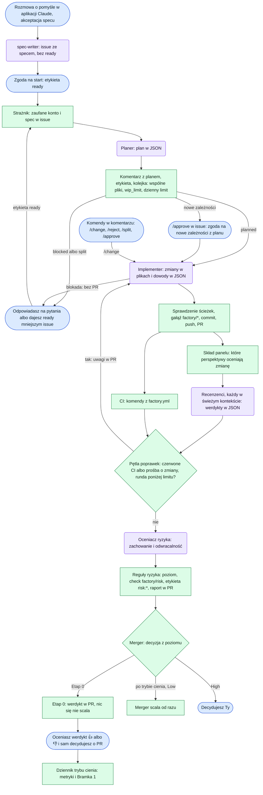

# Factory

Fabryka do wytwarzania oprogramowania, oparta na Claude Code i GitHub Actions. Zamienia rozmowę o pomyśle w zweryfikowany pull request z oceną ryzyka. Ty decydujesz, co się scala, i robisz to z telefonu.

> **Status: Etap 0, tryb cienia.** Taśma prowadzi zadanie od pomysłu do werdyktu w PR, ale niczego nie scala. Przy każdym PR zapisuje, co by zrobiła, a Ty oceniasz ten werdykt. Automatyczny merge Low włączy się po Bramce 1 (stan w dzienniku).

## Co potrafi

- **Spec z rozmowy, także z telefonu.** Skill `spec-writer` zapisuje pomysł jako notatkę albo dopytuje w krótkich rundach i zakłada issue z kryteriami akceptacji, które da się sprawdzić maszynowo. Taśmę uruchamiasz Ty, etykietą `ready`.
- **Plan i implementacja.** Planer rozpisuje pliki, testy i dowody, a za duże zadanie dzieli. Implementer pisze kod i testy w PR z gałęzi `factory/<numer>-<nazwa>` albo zgłasza blokadę zamiast połowicznego PR.
- **Recenzja.** CI uruchamia komendy projektu, a pięć perspektyw (poprawność, testy, bezpieczeństwo, utrzymanie, zgodność ze specem) ocenia PR, każda w świeżym kontekście. Projekt może dodać kolejne, np. recenzenta wyglądu na zrzutach ekranu.
- **Pętla poprawek.** Czerwone CI albo prośba recenzenta odsyła PR do implementera, do 3 rund. Konflikty z gałęzią główną taśma rozwiązuje sama.
- **Ocena ryzyka.** Deterministyczne reguły i ocena modelu, która może poziom tylko podnieść. Wynik: **Low** (fabryka scala sama) albo **High** (decydujesz Ty), z raportem czytelnym na telefonie.
- **Tryb cienia i dziennik.** Werdykt fabryki oceniasz 👍 albo 👎. Przypięte issue „Tryb cienia” pokazuje zgodność, rundy, czas i koszt.
- **Kolejka i limity.** Zadania na tych samych plikach idą po kolei, reszta równolegle w granicach `wip_limit`. Dzienny limit przebiegów pilnuje kosztu.
- **Bezpieczeństwo.** Claude działa tylko z prawem odczytu i zwraca JSON albo patch; zapisy robią skrypty. Nowe pakiety instaluje workflow po Twoim `/approve`.

**Jeszcze nie:** automatyczny merge (wymaga rulesetu na `main` i aplikacji GitHub fabryki, a w repo prywatnym GitHub Pro) i sesja `factory-init`, która ustala konwencje projektu. Do tego czasu konwencje zapisujesz sam w `CLAUDE.md` projektu.

## Szybki start

Potrzebujesz repo projektu na GitHubie (w prywatnym taśma zużywa minuty Actions), subskrypcji Claude Pro albo Max, raz komputera z Claude Code do wygenerowania tokenu, a na co dzień telefonu z aplikacją Claude i GitHub Mobile.

1. **Token.** Na komputerze `claude setup-token`, potem w repo projektu: Settings → Secrets and variables → Actions → sekret `CLAUDE_CODE_OAUTH_TOKEN`.
2. **Ustawienia repo.** Settings → Actions → General → Workflow permissions: zaznacz „Allow GitHub Actions to create and approve pull requests”.
3. **Kontrakt.** Skopiuj [`templates/factory.yml`](templates/factory.yml) do korzenia repo i ustaw presety (`extends`), komendy CI (`commands`: wymagane `test` i `build`, a `setup` instaluje wszystko, także przeglądarki do e2e), strefy (`zones`), komendy instalacji pakietów (`dependencies`) i pliki chronione. Sprawdź go w klonie fabryki (Node 22.18+): `npm ci && npm run validate -- ścieżka/do/factory.yml`.
4. **Konwencje.** Zapisz w `CLAUDE.md` projektu styl kodu i nazwy, a w projekcie z interfejsem także wspólne elementy (gdzie leżą i gdzie je widać, np. strona wzorców). Czytają je planer, implementer i recenzenci.
5. **Workflow.** Skopiuj [`templates/workflows/factory.yml`](templates/workflows/factory.yml) do `.github/workflows/factory.yml` i dopisz `.factory/review/` do `.gitignore`. To cienki plik: dyrygent fabryki (`pipeline.yml`) rozdziela zdarzenia na etapy.
6. **Spec z telefonu.** Skopiuj [`skills/spec-writer/`](skills/spec-writer/) do `.claude/skills/spec-writer/`, dopisz regułę z [`templates/claude/CLAUDE.md`](templates/claude/CLAUDE.md) do `CLAUDE.md` projektu i daj aplikacji Claude dostęp do repo (claude.ai → GitHub). Szczegóły: [Spec z telefonu](#spec-z-telefonu).

**Pierwsze zadanie:** w aplikacji Claude otwórz zakładkę Code, sesję na repo projektu i napisz „Mam pomysł: …”. Spec-writer zapyta „notatka czy spec?”, dopyta o decyzje i założy issue. Na Twoją zgodę doda `ready`. Po kilku minutach w issue jest plan, potem PR z raportem ryzyka i werdyktem. Werdykt oceniasz 👍 albo 👎, a o PR decydujesz jak zwykle: merge albo `/reject`. Postęp widać w Actions → factory: nazwa przebiegu mówi, który etap ruszył.

**Aktualizacje.** Projekt przypina wersję fabryki w workflowie (`@main` i `factory_ref: main` w Etapie 0, potem tag `v1`). Etapy, skille, presety i skrypty przychodzą z tej wersji same. Ręcznie synchronizujesz tylko kopię skilla `spec-writer`.

## Na co dzień: etykiety i komendy

| Etykieta w issue | Znaczy |
| --- | --- |
| `idea` | notatka bez specu; spec zrobisz z niej później |
| `ready` | spec gotowy; nadajesz ją Ty, uruchamia planera |
| `planned` | plan jest; implementacja trwa albo PR jest otwarty |
| `queued` | czeka w kolejce (wspólne pliki, `wip_limit` albo dzienny limit); ruszy samo |
| `needs-approval` | plan dodaje pakiety; czeka na Twoje `/approve` |
| `blocked` | potrzebna Twoja decyzja; powód w komentarzu |
| `split` | planer podzielił zadanie na mniejsze issue |
| `factory:paused` | taśma stoi, a etap czeka na wznowienie (też w PR) |
| `factory:stopped` | issue zatrzymania taśmy: otwarte, dopóki taśma stoi |

W PR: `risk:low` albo `risk:high`, `factory:round-N` (runda poprawek), `factory:change-N` (runda po Twoim `/change`) i `factory:conflict-N` (runda rozwiązania konfliktu).

| Komenda | Gdzie | Co robi |
| --- | --- | --- |
| `/approve` | issue z `needs-approval` | zgoda na nowe pakiety z planu |
| `/approve` | PR | etykieta `factory:approved`; po trybie cienia pozwoli scalić PR z High |
| `/change <opis>` | PR | runda poprawek według Twojego opisu |
| `/reject` | issue albo PR | odrzuca zadanie, zamyka PR i zwalnia kolejkę |
| `/split` | issue | planer dzieli zadanie na mniejsze issue |
| `/stop <powód>` | issue albo PR | zatrzymuje taśmę; dziennik i komendy działają dalej |
| `/start` | issue albo PR | wznawia taśmę i wstrzymane etapy, sprawdza kolejkę |

Komendy działają tylko od właściciela repo i kont z wejścia `trusted`, bez względu na wielkość liter. Na nieznaną komendę taśma odpowiada listą komend.

- **Zatrzymanie taśmy** to linka bezpieczeństwa: `/stop` otwiera issue z powodem, trwający etap kończy pracę, a kolejne czekają z etykietą `factory:paused`, aż napiszesz `/start`.
- **Limit subskrypcji Claude** zatrzymuje taśmę sam. Etap, który na niego trafi, czeka zamiast kończyć się blokadą, a taśma otwiera issue z godziną resetu. Pierwsze zdarzenie po tej godzinie wznawia etapy; wcześniej możesz napisać `/start`.
- **Problemy taśmy**, czyli kłopoty z narzędziami albo komendami projektu, agenci zgłaszają w planie, w opisie PR albo przy blokadzie. Dziennik zbiera je w sekcji „Problemy taśmy”, a o `/stop` decydujesz Ty.

## Jak działa

Niebieskie kroki wykonuje człowiek, fioletowe agent (Claude, tylko odczyt), a zielone skrypt w GitHub Actions.



Po wyjściu z trybu cienia merger scali Low od razu, a High zostawi Tobie. Scala deterministyczny skrypt, nie model. Etapy mówią, który Low scala się sam: najpierw treści (dokumentacja, testy, teksty, poprawki zależności), potem kod.

### Pętla poprawek i blokady

- **Runda poprawek.** Czerwone CI albo `request_changes` odsyła PR do implementera z komentarzem „Runda poprawek N z M”: uwagi od najpoważniejszej, a przy czerwonym CI końcówka wyjścia padających komend. Przy czerwonym CI recenzenci nie ruszają, chyba że to ostatnia runda; po poprawce cały panel ocenia PR od nowa. Uwagi nierozstrzygnięte po `risk.max_review_rounds` rundach dają High.
- **Zadanie rundy** to uwagi z komentarza, nie issue od nowa. Twoje `/change` implementer wykonuje albo kończy blokadą z powodem; takie rundy nie zmniejszają limitu. Gdy żadna uwaga nie wymaga zmiany kodu, implementer oddaje rundę bez zmian z wyjaśnieniem, a recenzja rusza jeszcze raz.
- **Co widzą recenzenci.** Każdy dostaje Twoje polecenia `/change` jako decyzje ważniejsze od specu, wynik CI z końcówką wyjścia każdej komendy (`ci.json`) i porównanie zrzutów z gałęzią główną. Recenzent wyglądu dostaje też uwagi, na które odpowiadała runda, żeby nie żądał ich odwrotności.
- **Konflikty z gałęzią główną.** Każda runda zaczyna od scalenia gałęzi głównej: bez konfliktu robi to skrypt, a konflikty rozwiązuje implementer. Po zamknięciu PR fabryki kolejka sprawdza pozostałe otwarte PR i uruchamia rundę rozwiązania konfliktu (najwyżej 2 na PR, poza limitem rund).
- **Blokada.** Gdy implementer nie może dokończyć zadania, nie ma PR ani recenzji: issue dostaje `blocked` i komentarz z powodem. Brak sprawdzenia, które i tak zrobi CI, nie jest blokadą. Gdy sesja Claude nie wystartuje, etap próbuje jeszcze raz po minucie.
- **Nowe zależności.** Planer wpisuje pakiety z wersją do planu. Plan czeka z `needs-approval` na Twoje `/approve`, a potem workflow instaluje pakiety komendami z `dependencies`. Implementer nie dostaje komendy instalacji, bo w jego jobie działa token subskrypcji.

### Kolejka i limity

- Zadanie, które dzieli pliki z zadaniem w toku (z planu albo z otwartego PR), albo ponad `wip_limit` czeka z etykietą `queued`.
- `daily_runs` to dzienny limit przebiegów z Claude (plan, implementacja, recenzja). Sprawdza go implementacja nowego zadania; rundy poprawek otwartego PR go nie sprawdzają.
- Kolejka rusza po zamknięciu PR fabryki, po `/reject`, `/start`, zgodzie na zależności, blokadzie i raz dziennie z harmonogramu, który GitHub uruchamia z opóźnieniem, zwykle o kilka godzin.

### Zrzuty ekranu

Odpowiadają na pytanie, czy zmiana wygląda jak wzorzec. Projekt podaje komendę w `factory.yml`:

```yaml
evidence:
  screenshots: npx playwright test -c playwright.screenshots.config.ts
```

- Komenda zapisuje PNG w katalogu `$FACTORY_SCREENSHOTS`: `<nazwa>@<szerokość>.png` to wykonanie, a `.ref.png` to wzorzec tej samej sekcji. Lepiej działają zrzuty sekcji niż całej strony. Limity: 400 plików, 5 MB na plik, 100 MB razem.
- Taśma robi te same zrzuty na punkcie rozgałęzienia i porównuje piksele. Recenzent wyglądu `ux-visual` (włączasz go w `reviewers.extra`) dostaje tylko sekcje zmienione przez PR, a gdy nic się nie zmieniło, werdykt wystawia skrypt bez Claude.
- Komentarz „Zrzuty ekranu” w PR ma linki do par wzorzec–wykonanie, bo GitHub nie pokazuje w komentarzach obrazów z repo prywatnego. Obrazy leżą na gałęzi `factory-screenshots`, którą możesz usunąć w każdej chwili.
- Brak zmian wyglądu dowodzi samo porównanie zrzutów, więc w repo nie trzeba trzymać wzorców zrzutów całej strony.

### Tryb cienia

Po ocenie ryzyka taśma dodaje w PR komentarz z werdyktem: Low „scaliłaby”, High „przekazałaby Tobie”, a za duża zmiana albo blokada bramek jakości wraca do podziału albo poprawek. Reagujesz 👍 albo 👎; każda kolejna ocena dostaje nowy komentarz. Dziennik w przypiętym issue „Tryb cienia” odświeża się po werdykcie, po zamknięciu PR fabryki i raz dziennie, a statystyki zapisuje w `journal.csv` i `journal.json` na gałęzi `factory-journal`.

Metryki liczy skrypt:

- **zgodność**: odsetek werdyktów ocenionych 👍. Werdykt „scaliłaby”, po którym napisałeś `/change`, liczy się jako 👎, bo PR scaliłby się bez Twojej poprawki. `/change` po eskalacji to zgoda. Dawne werdykty Medium dziennik liczy jako eskalacje („było Medium”);
- **fałszywe Low**: werdykt „scaliłaby” oceniony 👎, PR zamknięty bez merge'u albo cofnięty w ciągu `revert_days` dni;
- **rundy poprawek**, **czas od `ready` do merge'u** i **koszt** (równowartość cen API na PR, etap i recenzenta);
- **próg pewności recenzentów**: odsetek przyjętych PR przy pewności ≥ 0,8 i poniżej. Podobne liczby znaczą, że pewność nie przewiduje Twoich decyzji.

**Bramka 1** przechodzi, gdy w ostatnich 20 ocenionych PR (`gate_prs`) zgodność wynosi co najmniej 90%, nie ma fałszywych Low i jest co najmniej 8 trafnych Low (`min_low`: „scaliłaby” z Twoim 👍). Dziennik pokaże, że można wyjść z trybu cienia; decyzja należy do Ciebie.

## Szczegóły

### Reguły ryzyka

Poziom zmiany to najwyższy wynik z pięciu reguł; reguły i oceniacz mogą go tylko podnieść. Low wymaga, żeby każda reguła dała Low. Ocenia `scripts/risk-rules.ts`, a ten sam diff daje zawsze ten sam wynik.

| Reguła | Low tylko wtedy, gdy |
| --- | --- |
| 1. Strefy | każdy zmieniony plik (przy zmianie nazwy stara i nowa ścieżka) jest w strefie Low; ścieżka spoza mapy stref to High, a plik testów spoza mapy liczy się jak `code` |
| 2. Zachowanie i odwracalność | oceniacz ryzyka (LLM) dał Low, a spec nie ma wysokiego ryzyka produktowego; bez oceny nie ma Low |
| 3. Brak testów | kod (`files.source`) leży w strefie, która ma testy w swoich ścieżkach albo w `zone_tests` |
| 4. Rozmiar | najwyżej 100 linii i 5 plików kodu produkcyjnego (bez testów, lockfile'ów, plików generowanych i tłumaczeń); ponad 400 linii albo 15 plików zmiana wraca do planera do podziału |
| 5. Dowody | zielone CI, dowód dla każdego kryterium akceptacji, test regresji przy poprawce błędu, `approve` każdej perspektywy z panelu z pewnością ≥ 0,8, każdy cytat recenzenta obecny w diffie, brak nowych znaczników wyłączeń, brak usuniętych testów i ubytku asercji, pokrycie zmienionych linii ≥ 80% (gdy CI je liczy) |

`factory.yml` jest czytany z punktu rozgałęzienia, więc PR nie poluzuje własnej oceny. `approve` z uwagą o wadze `high` albo `critical` liczy się jak `request_changes`.

Bramki jakości nie są ryzykiem: blokują merge, ale fabryka poprawia je sama. Liczą się tylko zmienione pliki.

| Bramka | Próg |
| --- | --- |
| Długość pliku | ostrzeżenie przy 300 liniach, blokada przy 500; pliki już większe nie mogą rosnąć |
| Długość funkcji | 50 linii |
| Złożoność | 15 |
| Zagnieżdżenie | 4 |

### Kontrakt projektu (`factory.yml`)

Warstwy składają się w kolejności `base` → presety z `extends` → `factory.yml`. Listy się sumują, więc projekt nie usunie ochrony z `base`; pojedyncze wartości nadpisuje późniejsza warstwa. Presety: `base`, `typescript`, `web`, `nuxt`.

| Pole | Kto ustawia | Co znaczy |
| --- | --- | --- |
| `project`, `extends` | projekt | nazwa projektu; presety, `base` zawsze pierwszy |
| `commands` | projekt | komendy CI; wymagane `test` i `build`; implementer uruchamia tylko te |
| `dependencies` | projekt | `add` i `add_dev`: instalacja zatwierdzonych pakietów, workflow dokleja `nazwa@wersja` |
| `zones`, `zone_tests` | wszystkie warstwy | ścieżki stref (`data`, `security`, `release`, `dependencies`, `factory`, `shared`, `code`) i testy spoza ścieżek strefy, które ją sprawdzają |
| `files`, `disable_markers`, `assertion_markers` | wszystkie warstwy | klasy plików (kod, testy, lockfile'y, generowane, tłumaczenia), znaczniki wyłączeń i asercji |
| `protected_files` | wszystkie warstwy | pliki, których agenci nie zapisują |
| `risk`, `gates`, `shadow` | tylko `base` | poziomy stref, progi reguł ryzyka, bramek jakości i Bramki 1 |
| `exceptions` | projekt | wyjątek od bramki jakości dla ścieżki, zawsze z powodem |
| `reviewers` | `base`, projekt (`extra`) | perspektywy recenzji |
| `models` | `base`, projekt | model na etapie i dla wybranych perspektyw |
| `wip_limit`, `daily_runs` | `base`, projekt | zadania w toku naraz i dzienny limit przebiegów z Claude |
| `evidence.screenshots` | projekt | komenda zrzutów ekranu |

Wzorce ścieżek są względne od korzenia repo i znają `*`, `**` i `?`; wzorzec zaczynający się od `*` ujmij w YAML-u w cudzysłów. Błąd walidacji wskazuje plik i pole.

### Agenci

| Agent | Kiedy | Wyjście |
| --- | --- | --- |
| `spec-writer` | rozmowa o pomyśle w aplikacji Claude | notatka albo issue ze specem |
| `planner` | etykieta `ready` | plan w komentarzu i JSON: `planned`, `blocked` albo `split` |
| `implementer` | plan, `/change`, runda poprawek albo konflikt | zmiany w plikach i JSON: `done` albo `blocked`, dowód dla każdego kryterium |
| `review-<perspektywa>` | po CI, równolegle | werdykt w JSON; tylko `Read`, `Grep` i `Glob` |
| `risk-assessor` | po recenzji | reguła 2: Low albo High z uzasadnieniem |

Agenci nie ustawiają etykiet ani checków: workflowy działają na ich JSON-ie po sprawdzeniu schematu (`scripts/agents/output.ts`). Recenzenci mają wspólny protokół `skills/review/protocol.md` i kryteria w `skills/review/perspectives/`; pliki `agents/review-*.md` generuje `npm run agents`. Implementer nie zmieni plików chronionych ani `.github/`: taki patch odrzuca skrypt.

### Spec z telefonu

Spec-writer najpierw pyta „notatka czy spec?”. Notatka to issue z Twoją wiadomością i etykietą `idea`; spec zrobisz z niej później („zrób spec z #N”) albo podzielisz ją przez `/split`. Spec powstaje w rundach: najwyżej 5 pytań w wiadomości, każde z proponowaną odpowiedzią, a po 3 rundach z otwartymi decyzjami spec-writer proponuje podział. Issue powstaje bez `ready`; spec-writer dodaje ją dopiero na Twoją zgodę. Każde issue ma blok „Wiadomość właściciela” z oryginałem.

Spec ma sekcje: Cel, Scenariusz, Kryteria akceptacji (sprawdzalne maszynowo), Poza zakresem, Założenia, Ryzyko produktowe i Projekt (szablon w [`skills/spec-writer/SKILL.md`](skills/spec-writer/SKILL.md)). Taśma planuje tylko issue ze specem.

- **Domyślnie: sesja Claude Code w repo projektu** (z telefonu: zakładka Code). Sesje w chmurze nie instalują pluginów, dlatego projekt trzyma kopię skilla i regułę w `CLAUDE.md`. Po zmianie skilla w fabryce kopię trzeba podmienić.
- **Opcjonalnie: zwykły czat.** `npm run skill:zip` tworzy `dist/spec-writer.zip`, który wgrywasz w claude.ai (Settings → Capabilities → Skills, z włączonym Code execution). Konektor GitHub potrzebuje repo projektu w instalacji swojej aplikacji GitHub, inaczej zapis kończy się błędem 403.

### Perspektywy i modele

Pięć perspektyw z `base` ocenia każdy PR: `correctness`, `tests`, `security`, `maintainability` i `spec`. Kolejne projekt włącza w `reviewers.extra`; każda ocenia tylko zmiany, których dotyczy:

| Perspektywa | Ocenia | Kiedy działa |
| --- | --- | --- |
| `ux-visual` | zrzuty sekcji zmienionych przez PR względem wzorca | zmiany widoku, stylów albo zasobów |
| `accessibility-web` | semantyka, teksty alternatywne, etykiety, kontrast, klawiatura | zmiany widoku albo stylów |
| `web-performance` | obrazy, rozmiar paczki, ładowanie, przesunięcia układu | zmiany kodu, stylów, zasobów albo builda |
| `devils-advocate` | szuka wejścia, które wywróci zmianę | strefy `data`, `security`, `release`, `dependencies` |

**Własna perspektywa** to plik `.factory/perspectives/<nazwa>.md` i jedna linia w `reviewers.extra`:

```markdown
---
name: brand
title: Zgodność z marką
description: Sprawdza kolory i typografię marki.
paths: ["src/components/**", "**/*.css"]   # opcjonalnie; albo zones: [shared]
screenshots: true                            # opcjonalnie: recenzent dostaje zrzuty zmienionych sekcji
---

Kryteria: na co recenzent patrzy i czego nie ocenia.
```

Najpierw tanie strażniki: limit rozmiaru paczki, Lighthouse czy axe w testach e2e kosztują mniej niż recenzent LLM przy każdym PR.

Modele startowe są w `base` (`planner: opus`, `implementer: sonnet`, `risk_assessor: sonnet`, recenzenci `sonnet`, `security: opus`). Projekt nadpisuje tylko to, co chce zmienić, np. `models.reviewers.ux-visual: haiku`.

### Workflowy i bezpieczeństwo

Projekt wywołuje tylko dyrygenta `pipeline.yml`, a ten etapy z tego repo w tej samej wersji. Uprawnienia przyznane przez projekt są sufitem; każdy job bierze z nich tylko swoje minimum.

| Etap | Uruchamia go | Co robi |
| --- | --- | --- |
| `pipeline.yml` | każde zdarzenie workflowu projektu | rozdziela zdarzenia na etapy; przy zatrzymanej taśmie zapisuje wstrzymane etapy |
| `plan.yml` | etykieta `ready` | plan w komentarzu, etykiety, start implementacji albo kolejka |
| `implement.yml` | plan, kolejka, `/change`, runda poprawek, konflikt | patch od implementera, sprawdzenie ścieżek, PR; przy blokadzie komentarz bez PR |
| `review.yml` | implementacja | CI, zrzuty ekranu, skład panelu, recenzenci, pętla poprawek |
| `risk.yml`, `merge.yml` | po recenzji | ocena ryzyka, check `factory/risk`, raport i werdykt w PR |
| `journal.yml` | werdykt, zamknięcie PR fabryki, raz dziennie | dziennik i statystyki; po scaleniu zamyka issue |
| `queue.yml` | zamknięcie PR fabryki, komendy, raz dziennie | wypuszcza czekające zadania, wykrywa konflikty otwartych PR |
| `commands.yml` | komentarz właściciela | komendy z tabeli wyżej |

Wejścia szablonu: `factory_ref` (wersja skryptów, ta sama co w `uses`), `runs_on` (np. własny runner dla repo prywatnego), `trusted` (dodatkowe zaufane konta), `max_parallel` (recenzenci naraz).

- Joby z Claude mają tylko prawo odczytu i repo bez poświadczeń git. Komentarze, etykiety, commit, PR i check robią osobne joby bez Claude, na sprawdzonym wyjściu.
- Na taśmę wchodzą tylko zdarzenia od właściciela, kont `trusted` i workflowów fabryki. Etapy łączy `workflow_dispatch`, bo zdarzenia z `GITHUB_TOKEN` nie uruchamiają workflowów.
- Galeria zrzutów, dziennik i kolejka nie pobierają kodu PR ani nie uruchamiają Claude. Prawo zapisu treści mają tylko do gałęzi `factory-*`.
- Testy w `scripts/workflow/workflows.test.ts` pilnują tych zasad na samych plikach YAML.

### Plugin w Claude Code

To repo jest też marketplace'em pluginu ze skillami fabryki do pracy lokalnej: `/plugin marketplace add gibkigonzo/factory`, potem `/plugin install factory@factory`. Taśma pluginu nie potrzebuje.

## Struktura repo

```
.claude-plugin/       plugin.json i marketplace.json (plugin = całe repo)
skills/               skille: spec-writer, planner, implementer, review (protokół i perspektywy), risk-assessor
agents/               recenzenci review-<perspektywa>, generowani z skills/review
scripts/              deterministyczne skrypty: kontrakt, reguły ryzyka, panel, wyjście agentów, kolejka,
                      pętla poprawek, budżet, zrzuty, merger i dziennik trybu cienia
presets/              warstwy reguł: base, typescript, web, nuxt
templates/            szablony dla projektów: workflow taśmy, reguła dla CLAUDE.md, factory.yml
.github/workflows/    wspólne workflowy typu workflow_call
```
