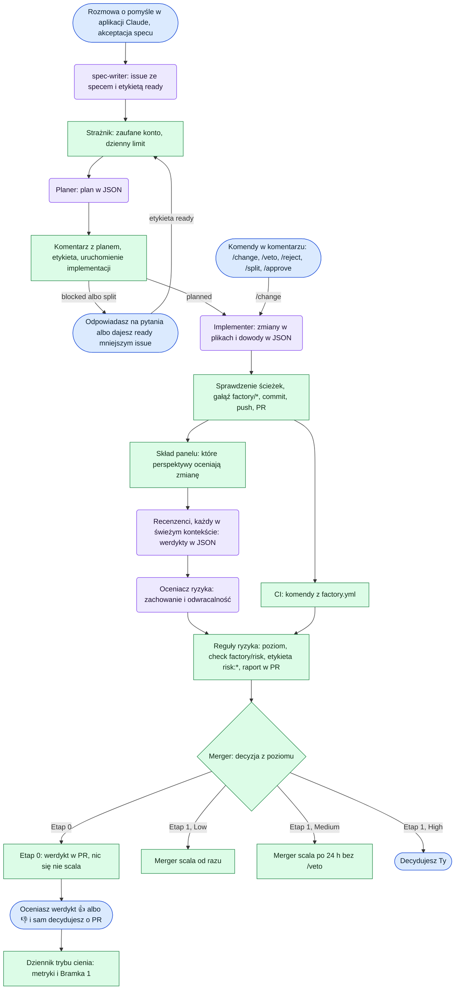

# Factory

Generyczna fabryka oprogramowania oparta na Claude Code. Zamienia rozmowę o pomyśle w scalony, zweryfikowany kod. Działa dla stron WWW i dla gier w Godot.

> **Status:** Etap 0 (tryb cienia). Taśma prowadzi zadanie od issue do werdyktu fabryki w PR, ale niczego nie scala. O przejściu do Etapu 1 rozstrzyga Bramka 1 w dzienniku trybu cienia.

## Jak działa

1. Spec powstaje w rozmowie w aplikacji Claude. Skill `spec-writer` zakłada issue z etykietą `ready`.
2. Planer rozpisuje zadanie, a implementerzy pracują równolegle na gałęziach `factory/*`.
3. Panel recenzentów ocenia każdy PR z 5–8 perspektyw. Każdy recenzent pracuje w świeżym kontekście.
4. Oceniacz ryzyka nadaje poziom zmiany:
   - **Low** scala się automatycznie;
   - **Medium** scala się po 24 h, jeśli nikt nie da `/veto`;
   - **High** czeka na decyzję właściciela, który nie czyta kodu, tylko decyduje.

Scala deterministyczny skrypt, a nie model. Fabryka nie może zmieniać własnych zabezpieczeń.

### Przebieg

Niebieskie kroki wykonuje człowiek, fioletowe agent (Claude, tylko odczyt, zwraca JSON albo patch), a zielone skrypt, czyli deterministyczny job w GitHub Actions.



W Etapie 0 (tryb cienia) fabryka niczego nie scala. Przy każdym PR zapisuje, co by zrobiła, a decyduje właściciel. Merger włącza się w Etapie 1, po przejściu Bramki 1.

### Tryb cienia

1. Po ocenie ryzyka `merge.yml` dodaje w PR komentarz z werdyktem fabryki. Low: scaliłaby od razu. Medium: czekałaby 24 h na `/veto`. High: przekazałaby decyzję Tobie. Zmiana za duża albo zablokowana przez bramki jakości: odesłałaby ją do podziału albo do poprawek.
2. Na komentarz reagujesz 👍 (zgoda) albo 👎 (niezgoda). Każda runda poprawek dostaje nowy komentarz, więc ocena dotyczy konkretnego werdyktu. O samym PR decydujesz jak zwykle: merge, `/reject` albo revert.
3. `journal.yml` prowadzi przypięte issue „Tryb cienia” (etykieta `factory:journal`): stan Bramki 1, metryki i listę PR-ów fabryki. Reakcje nie uruchamiają workflowów, więc dziennik odświeża się po każdym werdykcie, po zamknięciu PR fabryki i raz dziennie. Na żądanie: Actions → factory → Run workflow → `journal`.

Metryki liczy skrypt, nie model:

- **zgodność**: odsetek werdyktów, które oceniłeś 👍;
- **fałszywe Low**: werdykt „scaliłaby”, który oceniłeś 👎, PR zamknięty bez merge'u albo merge cofnięty w ciągu `revert_days` dni;
- **rundy poprawek** i **czas od `ready` do merge'u**;
- **próg pewności recenzentów**: zakończone PR-y dzielone według najniższej pewności w panelu (≥ 0,8 i < 0,8) z odsetkiem przyjętych (scalonych i niecofniętych) w każdej grupie. Jeśli odsetek jest podobny, pewność nie przewiduje Twoich decyzji i próg zastąpią zgodność recenzentów oraz cytaty, które da się sprawdzić.
- **koszt**: równowartość cen API na PR i na etap (plan, implementacja, recenzja, ocena ryzyka) oraz tokeny wyjścia. Przy subskrypcji pokazuje, ile taśma waży w limitach. Każdy etap z Claude zapisuje zużycie z pliku przebiegu `claude-code-action`: planer w komentarzu planu, implementer w opisie PR (wszystkie rundy), recenzenci i oceniacz w danych werdyktu.

Bramka 1 przechodzi przy 20 ocenionych PR, zgodności co najmniej 90% i braku fałszywych Low (progi `shadow` w `base`). Dziennik pokazuje wtedy, że można przejść do Etapu 1, ale decyzja należy do Ciebie.

## Reguły ryzyka v1

Poziom zmiany to najwyższy wynik z pięciu reguł. Reguły i oceniacz mogą go tylko podnieść.

| Reguła | Co sprawdza |
| --- | --- |
| 1. Strefy | ścieżki plików według mapy stref projektu; ścieżka spoza mapy dostaje Medium |
| 2. Zachowanie i odwracalność | ocena LLM, która może poziom tylko podnieść; zmiana sposobu liczenia kwot to Medium |
| 3. Brak testów | strefa bez testów jest o poziom wyżej |
| 4. Rozmiar | Low: maks. 100 linii i 5 plików; Medium: maks. 400 linii i 15 plików; większe zmiany planer dzieli |
| 5. Dowody | zielone CI, dowód dla każdego kryterium akceptacji, test regresyjny przy poprawce błędu, approve recenzentów z pewnością ≥ 0,8 |

Bramki jakości nie są ryzykiem: blokują merge, ale fabryka poprawia je sama.

| Bramka | Próg |
| --- | --- |
| Długość pliku | ostrzeżenie przy 300 liniach, blokada przy 500; pliki już większe nie mogą rosnąć |
| Długość funkcji | maks. 50 linii |
| Złożoność | maks. 15 |
| Zagnieżdżenie | maks. 4 |

## Jak projekt używa Factory

Reguły mają trzy warstwy: wspólne `base`, presety języka i frameworka oraz `factory.yml` projektu z mapą stref, komendami i wyjątkami.

- **Plugin.** To repo jest marketplace'em pluginu Claude Code. W `claude-code-action`:

  ```yaml
  plugin_marketplaces: https://github.com/gibkigonzo/factory.git
  plugins: factory@factory
  ```

  Lokalnie: `/plugin marketplace add gibkigonzo/factory`, potem `/plugin install factory@factory`. Sesje Claude Code w chmurze (także z telefonu) nie instalują pluginów z ustawień repo, więc skille potrzebne tam, jak `spec-writer`, projekt trzyma w `.claude/skills/`.
- **Workflowy.** Wspólne workflowy działają przez `workflow_call`:
  `uses: gibkigonzo/factory/.github/workflows/<name>.yml@v1`. Mogą je wywoływać także repozytoria prywatne.
- **Kontrakt.** Projekt dodaje `factory.yml` z `extends: [base, <język>, <framework>]`, np. `[base, typescript, web, nuxt]`. Preset `nuxt` zna układ Nuxt 4: komponenty, strony i zasoby w `app/` to Low, serwer, composables, layouty i pluginy to Medium, middleware to High. Wersje presetów przypina tagami.

## Kontrakt projektu (`factory.yml`)

Przykład jest w [`templates/factory.yml`](templates/factory.yml). Warstwy składają się w kolejności `base` → presety z `extends` → `factory.yml`. Listy z warstw się sumują, więc projekt może dopisać strefę albo chroniony plik, ale nie może usunąć tych z `base`. Pojedyncze wartości z późniejszej warstwy nadpisują wcześniejsze.

| Pole | Kto ustawia | Co znaczy |
| --- | --- | --- |
| `project`, `extends` | projekt | nazwa projektu; presety, `base` zawsze pierwszy |
| `commands` | projekt | komendy CI; wymagane `test` i `build`, reszta dowolna (`lint`, `e2e`, `scene_check`…) |
| `evidence` | projekt | `screenshots` (komenda) i `preview_deploy` (podgląd w PR) |
| `zones` | wszystkie warstwy | ścieżki w strefach: `data`, `security`, `release`, `dependencies`, `factory`, `shared`, `code` |
| `files` | wszystkie warstwy | klasy plików: `source` (kod), `tests`, `lockfiles`, `generated`, `translations` (reguły 3, 4 i bramki) |
| `disable_markers` | wszystkie warstwy | znaczniki wyłączeń (`eslint-disable`, `@ts-ignore`…), których nowe wystąpienia odbierają Low |
| `assertion_markers` | wszystkie warstwy | znaczniki asercji w testach (`expect(`, `assert`); ich ubytek daje High |
| `protected_files` | wszystkie warstwy | pliki, których agenci nie zapisują |
| `risk.zone_levels`, `risk.unassigned`, `risk.size`, `risk.min_confidence`, `risk.max_review_rounds`, `risk.min_diff_coverage` | tylko `base` | poziomy stref i progi reguł ryzyka |
| `risk.medium_veto_hours` | `base`, projekt | okno weta dla Medium; `0` = Medium jak High |
| `gates` | tylko `base` | progi bramek jakości |
| `exceptions` | projekt | wyjątek od bramki jakości dla ścieżki: `path`, `gate`, `max`, `reason` |
| `reviewers` | `base` (`perspectives`), projekt (`extra`) | perspektywy recenzji: podstawowe zawsze, dodatkowe z katalogu albo z `.factory/perspectives/` |
| `models` | `base`, projekt | model na etapie: `planner`, `implementer`, `risk_assessor`, `reviewers.default` i wybrane perspektywy |
| `human_gates` | projekt | etykiety kierujące PR do człowieka, np. `playtest: [feel]` |
| `wip_limit`, `daily_runs` | `base`, projekt | równoległe zadania i dzienne uruchomienia taśmy |
| `shadow` | tylko `base` | progi Bramki 1: `gate_prs`, `min_agreement`, `max_false_low`, `revert_days` |
| `schedules` | projekt | agenci cykliczni: `nightly`, `weekly` albo `off` |

Wzorce ścieżek są względne od korzenia repo i znają tylko `*` (w obrębie katalogu), `**` (dowolna głębokość, także zero katalogów) i `?`. Wzorzec zaczynający się od `*` trzeba w YAML-u ująć w cudzysłów.

Walidacja (Node 22.18+):

```bash
npm ci
npm run validate -- ścieżka/do/factory.yml
```

Błąd wskazuje plik i pole, np. `factory.yml: zones.data[1]: nieprawidłowy wzorzec "/abs/**": …`. Z `--json` skrypt wypisuje konfigurację złożoną z warstw.

## Skrypt reguł ryzyka

`scripts/risk-rules.ts` ocenia zmianę między dwiema wersjami repo projektu i zwraca poziom z uzasadnieniem każdej reguły oraz wynik bramek jakości. Ten sam diff daje zawsze ten sam wynik.

```bash
node scripts/risk-rules.ts --repo ścieżka/do/projektu --base origin/main --head HEAD \
  --evidence evidence.json --eslint eslint.json --json
```

- `factory.yml` jest czytany z punktu rozgałęzienia, a nie z samej zmiany. Zmiana `factory.yml` i tak jest High.
- **Reguła 1:** każdy zmieniony plik (przy zmianie nazwy stara i nowa ścieżka) trafia do najwyższej pasującej strefy.
- **Reguła 2:** poziom przychodzi od oceniacza ryzyka w `evidence.json`. Bez tej oceny zmiana nie dostanie Low. Ryzyko produktowe „wysokie” ze specu (`product_risk`) daje High bez względu na ocenę.
- **Reguła 3:** dotyczy kodu (`files.source`) w przypisanej strefie. Strefa ma testy, gdy w repo jest plik z `files.tests` pasujący do jej wzorców. Testy w osobnym katalogu trzeba przypisać do strefy w `factory.yml`, np. `code: ["e2e/**"]`.
- **Reguła 4:** liczy dodane i usunięte linie oraz pliki bez testów, lockfile'ów, plików generowanych i tłumaczeń. Zmiana ponad progi Medium dostaje High (bezpieczna wartość domyślna) i znacznik podziału: wraca do planera, a do właściciela trafia dopiero, gdy planer stwierdzi, że podziału nie da się zrobić (`split_impossible`).
- **Reguła 5:** Low wymaga zielonego CI, dowodu dla każdego kryterium akceptacji, testu regresji przy poprawce błędu, `approve` każdej perspektywy z panelu z pewnością co najmniej `min_confidence` i braku nowych znaczników wyłączeń w kodzie. Każdy brak daje Medium, także cytat recenzenta, którego nie ma w diffie. `approve` z uwagą o wadze `high` lub `critical` liczy się jak `request_changes`. High dają: nierozstrzygnięta uwaga `high` lub `critical`, usunięty plik testów, gdy testowany kod został (usunięcie testów razem z kodem to Medium), ubytek asercji, pokrycie zmienionych linii poniżej `min_diff_coverage` (gdy CI je liczy) i uwagi nierozstrzygnięte po `max_review_rounds` rundach poprawek.
- **Bramki:** długość pliku liczy skrypt (linie bez pustych i komentarzy). Długość funkcji, złożoność i zagnieżdżenie bierze z raportu `eslint --format json`. Liczą się tylko zmienione pliki.

`evidence.json` składają workflowy:

```json
{
  "ci": "success",
  "acceptance": [{ "criterion": "przycisk jest niebieski", "evidence": "zrzut: button.png" }],
  "bugfix": false,
  "reviews": [
    {
      "perspective": "security",
      "verdict": "request_changes",
      "confidence": 0.85,
      "summary": "Sprawdzony przepływ tokenu w kliencie API i logowanie błędów.",
      "findings": [
        { "severity": "high", "file": "src/api/client.ts", "line": 42, "issue": "Token trafia do logu", "evidence": "console.log(authHeader)" }
      ],
      "risk_signals": ["touches-auth"]
    }
  ],
  "review_rounds": 1,
  "diff_coverage": 92.5,
  "behavior": { "level": "Low", "reason": "zmiana wyglądu, cofa ją jeden revert" }
}
```

Werdykt recenzenta (`reviews[]`) ma stały format: perspektywa, `verdict` (`approve` albo `request_changes`), pewność 0–1, `summary` (co sprawdzone i dlaczego taki werdykt), uwagi z wagą i cytatem z diffu w `evidence` oraz sygnały ryzyka dla oceniacza.

## Agenci

| Agent | Kiedy | Wyjście |
| --- | --- | --- |
| `spec-writer` (skill) | rozmowa o pomyśle w aplikacji Claude | issue ze specem i etykietą `ready` |
| `planner` (skill) | issue z etykietą `ready` | plan w komentarzu i blok JSON: `planned`, `blocked` albo `split` |
| `implementer` (skill) | issue z etykietą `planned` | PR z gałęzi `factory/*` i blok JSON z dowodem dla każdego kryterium |
| `review` (skill) | PR z zielonym CI | uruchamia recenzentów i zbiera ich werdykty |
| `review-<perspektywa>` (subagenci) | w panelu recenzji | werdykt JSON; tylko `Read`, `Grep` i `Glob`, każdy w świeżym kontekście |
| `risk-assessor` (skill) | po panelu | reguła 2: poziom i uzasadnienie w JSON |

Agenci nie ustawiają etykiet ani checków. Zwracają blok JSON, a workflowy działają dopiero na jego sprawdzonej wersji:

```bash
node scripts/agents/output.ts <plan|implementation|verdict|behavior> odpowiedź-agenta.md
```

Recenzenci mają jedno źródło: wspólny protokół `skills/review/protocol.md` i kryteria w `skills/review/perspectives/<perspektywa>.md`. Pliki `agents/review-*.md` generuje `npm run agents`, a test pilnuje, żeby były aktualne.

### Spec z telefonu

Spec pisze skill `spec-writer` w rozmowie z Claude. Zadaje najwyżej 5 pytań o decyzje produktowe, każde z proponowaną odpowiedzią. Potem pokazuje spec i po Twoim „tak” zakłada issue z etykietą `ready`, a ta uruchamia planera.

Spec ma sekcje: Cel, Scenariusz, Kryteria akceptacji (sprawdzalne maszynowo), Poza zakresem, Założenia, Ryzyko produktowe (`niskie` albo `wysokie`) i Projekt. Szablon i przykład są w [`skills/spec-writer/SKILL.md`](skills/spec-writer/SKILL.md). Test pilnuje, żeby szablon, przykład i planer znały te same sekcje (`SPEC_SECTIONS` w `scripts/workflow/spec.ts`).

**Domyślnie: sesja Claude Code w repo projektu.** Z telefonu: zakładka Code w aplikacji Claude, nowa sesja na repo projektu i np. „Mam pomysł: …”. Projekt ma do tego dwie rzeczy:

1. kopię skilla: katalog [`skills/spec-writer/`](skills/spec-writer/) jako `.claude/skills/spec-writer/`. Sesje w chmurze czytają skille z checkoutu repo, a pluginów z `.claude/settings.json` nie instalują (sprawdzone w repo testowym 7 listopada 2026);
2. regułę z [`templates/claude/CLAUDE.md`](templates/claude/CLAUDE.md) w `CLAUDE.md` projektu: pomysł idzie do spec-writera i issue, a nie do implementacji w sesji. Bez niej sesja Code od razu koduje.

Po zmianie skilla w fabryce kopię w projekcie trzeba podmienić. To zmiana w strefie `factory`, więc zatwierdzasz ją Ty.

**Opcjonalnie: zwykły czat w aplikacji Claude.** Rozmowa startuje szybciej, ale skille w czacie są przypisane do konta, więc fabryka ich tam nie wgra. Robisz to sam, raz i ponownie po każdej zmianie skilla:

1. `npm run skill:zip` tworzy `dist/spec-writer.zip`.
2. W claude.ai: Settings → Capabilities → Skills, wgraj ZIP. Skille wymagają włączonego wykonywania kodu (Code execution).
3. Konektor GitHub potrzebuje prawa zapisu, a repo projektu musi być w instalacji jego aplikacji GitHub; inaczej zapis kończy się błędem 403.

W obu drogach issue zakłada Twoje konto, więc strażnik taśmy je przepuszcza. Bez narzędzia z prawem zapisu spec-writer pokaże spec do skopiowania, a issue założysz ręcznie z etykietą `ready`.

### Perspektywy

Pięć perspektyw z `base` ocenia każdy PR: `correctness`, `tests`, `security`, `maintainability` i `spec`. Projekt dopisuje kolejne w `reviewers.extra` wtedy, gdy ich potrzebuje:

| Perspektywa z katalogu | Ocenia | Kiedy działa |
| --- | --- | --- |
| `ux-visual` | zrzuty i podgląd względem specu albo wzorca | diff dotyka plików widoku, stylów albo zasobów |
| `accessibility-web` | semantyka, teksty alternatywne, etykiety, kontrast, klawiatura | diff dotyka plików widoku albo stylów |
| `web-performance` | obrazy, rozmiar paczki, ładowanie, przesunięcia układu | diff dotyka kodu, stylów, zasobów albo konfiguracji builda |
| `devils-advocate` | szuka wejścia, które wywróci zmianę | diff dotyka stref `data`, `security`, `release` albo `dependencies` |

**Własna perspektywa projektu** to plik `.factory/perspectives/<nazwa>.md` w repo projektu i jedna linia w `reviewers.extra`. Ocenia ją ogólny recenzent `review-project` według tego samego protokołu:

```markdown
---
name: brand
title: Zgodność z marką
description: Sprawdza kolory i typografię marki.
paths: ["src/components/**", "**/*.css"]   # opcjonalnie; albo zones: [shared]
---

Kryteria: na co recenzent patrzy i czego nie ocenia.
```

Bez `paths` i `zones` perspektywa ocenia każdy PR. Skład panelu dla zmiany podaje `node scripts/review/panel.ts --base origin/main`, a reguły ryzyka wymagają werdyktu dokładnie od tych perspektyw. Pliki `.factory/` są w strefie `factory` (High) i są czytane z wersji bazowej, więc zmiana nie poluzuje własnej recenzji. Katalog roboczy panelu `.factory/review/` dopisz do `.gitignore` projektu.

**Najpierw tanie strażniki.** Recenzent LLM kosztuje przy każdym PR. Gdzie się da, lepiej od początku mieć deterministyczny test w CI, a jego wynik dołączyć do artefaktów jako dowód. Przykłady: limit rozmiaru paczki, próg Lighthouse, test dostępności axe w testach e2e. Recenzent z perspektywy korzysta z tych raportów, a sama perspektywa przydaje się, gdy projekt dojrzeje.

### Modele

Każdy etap może używać innego modelu, także po to, żeby oszczędzać limity. Wartości startowe są w `base`:

```yaml
models:
  planner: opus          # mało wywołań, a od planu zależy reszta
  implementer: sonnet    # najwięcej tokenów
  risk_assessor: sonnet
  reviewers:
    default: sonnet      # kilka wywołań na każdy PR
    security: opus       # najwyższa stawka
```

Projekt nadpisuje w `factory.yml` tylko to, co chce zmienić, np. `models.reviewers.ux-visual: haiku`. Wartość to alias (`opus`, `sonnet`, `haiku`) albo pełny identyfikator modelu. Model można ustawić tylko dla włączonej perspektywy. Workflowy podają model każdemu jobowi.

## Taśma w GitHub Actions

Projekt podłącza taśmę w czterech krokach:

1. kopiuje [`templates/workflows/factory.yml`](templates/workflows/factory.yml) do `.github/workflows/factory.yml`;
2. kopiuje [`skills/spec-writer/`](skills/spec-writer/) do `.claude/skills/spec-writer/` i dopisuje [`templates/claude/CLAUDE.md`](templates/claude/CLAUDE.md) do `CLAUDE.md` projektu, żeby spec powstawał w sesji Claude Code, także z telefonu;
3. dodaje sekret `CLAUDE_CODE_OAUTH_TOKEN` (Settings → Secrets and variables → Actions);
4. w Settings → Actions → General → Workflow permissions zaznacza „Allow GitHub Actions to create and approve pull requests”, bez czego workflow nie otworzy PR.

Dalej wszystko dzieje się w issue i PR, także z telefonu.

| Etap | Uruchamia go | Co robi |
| --- | --- | --- |
| `plan.yml` | etykieta `ready` na issue | plan w komentarzu, etykieta `planned`, `blocked` albo `split`; przy `planned` uruchamia implementację |
| `implement.yml` | plan albo `/change` w PR | patch od implementera, sprawdzenie ścieżek, PR z gałęzi `factory/<numer>-<nazwa>`; uruchamia recenzję |
| `review.yml` | implementacja | komendy z `factory.yml` (CI), skład panelu, recenzenci równolegle |
| `risk.yml` | po recenzji, w tym samym uruchomieniu | oceniacz ryzyka, reguły, check `factory/risk`, etykieta `risk:*`, raport w PR |
| `merge.yml` | po ocenie ryzyka, w tym samym uruchomieniu | w Etapie 0 tylko werdykt trybu cienia w nowym komentarzu |
| `journal.yml` | po werdykcie, po zamknięciu PR fabryki, raz dziennie | dziennik trybu cienia w przypiętym issue |
| `commands.yml` | komentarz od właściciela | `/approve`, `/veto`, `/reject`, `/change <opis>`, `/split` |

**Bezpieczeństwo:**

- Joby z Claude mają tylko prawo odczytu i repo bez poświadczeń git. Zwracają JSON (`--json-schema`) albo patch.
- Komentarze, etykiety, gałąź, commit, push, PR i check robią osobne joby bez Claude, na podstawie sprawdzonego wyjścia.
- Implementer nie zmieni plików z `protected_files` ani `.github/`: patch odrzuca skrypt, zanim trafi do repo.
- Etapy łączy `workflow_dispatch`, bo zdarzenia z `GITHUB_TOKEN` nie uruchamiają innych workflowów. W Etapie 0 zmiany podpisuje `github-actions[bot]`; własna aplikacja GitHub fabryki przyjdzie w Etapie 1.
- Na taśmę wchodzą tylko zdarzenia od właściciela repo, kont z wejścia `trusted` i workflowów fabryki. Komendy wydaje tylko człowiek.
- `factory.yml` i perspektywy projektu w recenzji i ocenie pochodzą z gałęzi bazowej.
- Dziennik uruchamia też `pull_request_target` przy zamknięciu PR z gałęzi `factory/*` tego repo. Nie pobiera kodu z PR: czyta gałąź główną i API.

**Ustawienia** (wejścia w szablonie): `factory_ref` (wersja fabryki; w Etapie 0 `main`), `runs_on` (np. `'["self-hosted", "vps"]'` dla własnego runnera w repo prywatnym), `trusted`, `max_parallel` (recenzenci naraz). Modele bierze z `models` w `factory.yml`, a dzienny limit z `daily_runs` (liczą się uruchomienia etapów przez `workflow_dispatch`).

Testy w `scripts/workflow/workflows.test.ts` pilnują tych zasad na samych plikach YAML: Claude bez prawa zapisu, akcje przypięte do commitów, żadnych wyrażeń wklejonych w skrypty, uprawnienia szablonu pokrywają uprawnienia jobów, merger i dziennik bez Claude.

## Struktura repo

```
.claude-plugin/       plugin.json i marketplace.json (plugin = całe repo)
skills/               skille: spec-writer, planner, implementer, review, risk-assessor; później po-scout, factory-init
agents/               recenzenci review-<perspektywa>, generowani z skills/review, tylko do odczytu
hooks/                hooks.json: blokada chronionych plików, Stop dopiero po zielonych testach
scripts/              deterministyczne skrypty: kontrakt, reguły ryzyka, skład panelu, wyjście agentów, merger
presets/              warstwy reguł: base, typescript, web, nuxt; później gdscript, godot
templates/            szablony dla projektów: workflow taśmy (templates/workflows/factory.yml), reguła dla CLAUDE.md projektu (templates/claude/CLAUDE.md), przykładowy factory.yml
.github/workflows/    wspólne workflowy typu workflow_call
```
